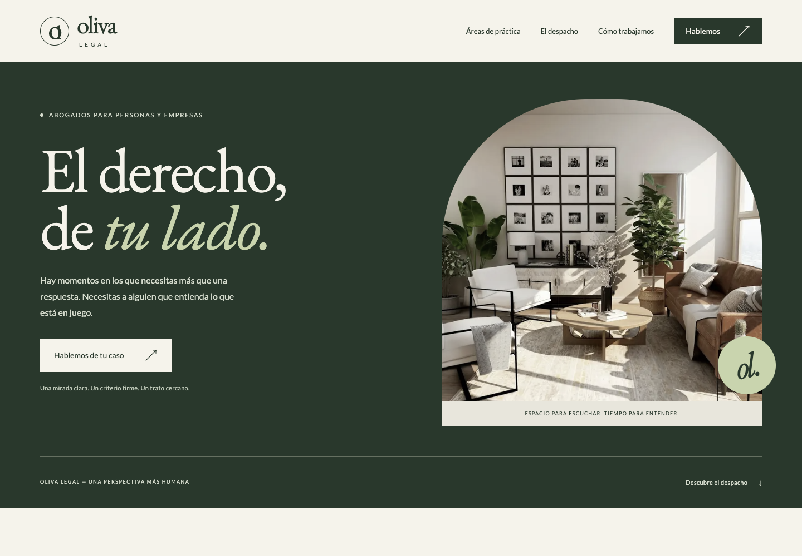

# Oliva Legal

Landing page editorial para un despacho de abogados ficticio. Un proyecto de portfolio centrado en identidad visual, desarrollo estático, accesibilidad y una experiencia de contacto clara.

[Ver la demo](https://arcas0803.github.io/oliva-legal/)



## Ejecutar

Requisitos: Node.js 22.12 o superior y npm. Las pruebas y auditorías utilizan Google Chrome instalado.

```sh
npm ci
npm run dev
```

```sh
npm run check
npm run build
npm run preview
npm test
npm run audit
```

La vista de producción se sirve en `http://127.0.0.1:4377`.

## Diseño y desarrollo

Astro genera HTML estático. Tailwind está integrado mediante Vite y el sistema visual utiliza variables CSS, EB Garamond y Lato alojadas localmente. Las imágenes se optimizan a WebP con variantes responsive. La interactividad usa JavaScript sin hidratación de componentes.

- Menú móvil con soporte de teclado y Escape.
- Áreas que preseleccionan el motivo de contacto.
- Preguntas frecuentes con HTML nativo.
- Formulario con validación, errores por campo y confirmación accesible.
- Diálogos de información y privacidad.
- Respeto de la preferencia de movimiento reducido.

El formulario es exclusivamente demostrativo: no envía ni almacena datos. La marca y los contenidos son ficticios; no constituyen asesoramiento jurídico. El sitio mantiene `noindex, nofollow`.

## Publicación

El workflow publica en GitHub Pages desde `main`. Para reutilizarlo, ajusta `SITE_URL` y `BASE_PATH` en `.github/workflows/deploy.yml` y habilita Pages con GitHub Actions. No hay credenciales ni servicios externos en el código del cliente.

## Recursos

Fotografía de interior: [imagen original de Unsplash](https://images.unsplash.com/photo-1600210492486-724fe5c67fb0). Uso bajo la [licencia de Unsplash](https://unsplash.com/license).

Tipografías: [EB Garamond](https://fontsource.org/fonts/eb-garamond) (SIL Open Font License) y [Lato](https://fontsource.org/fonts/lato) (SIL Open Font License), distribuidas mediante Fontsource. Sus licencias se incluyen en los paquetes originales.

Consulta `docs/design-plan.md` para las decisiones de diseño y `docs/audit.md` para el alcance de las comprobaciones.
